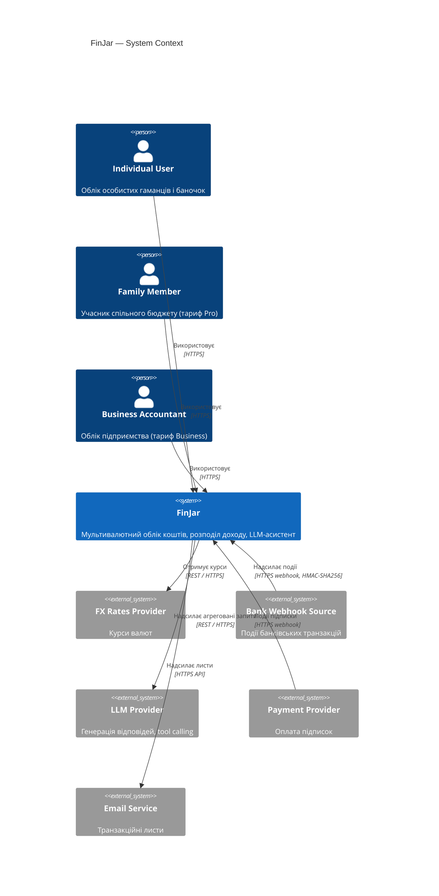
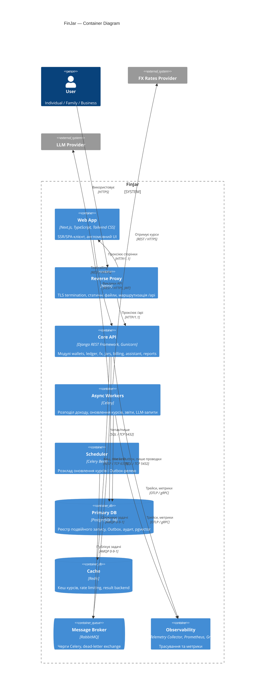
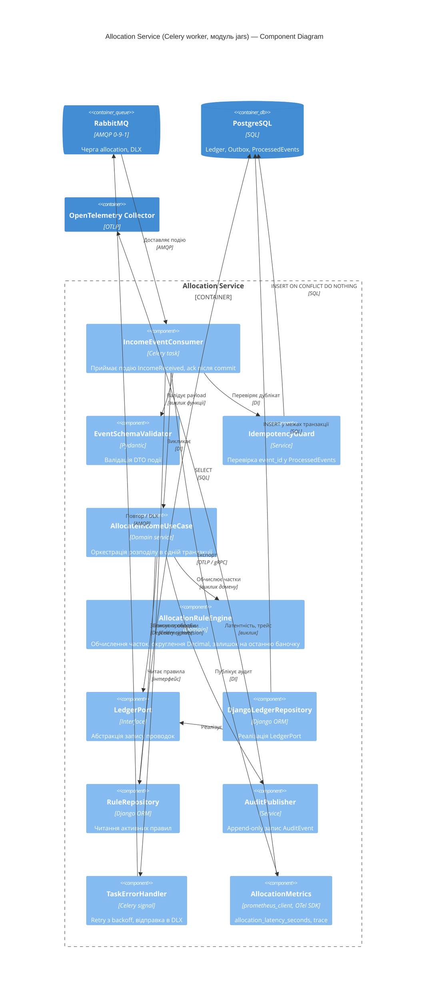
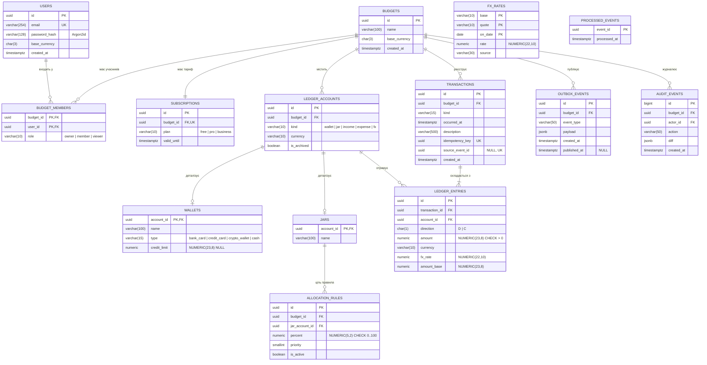
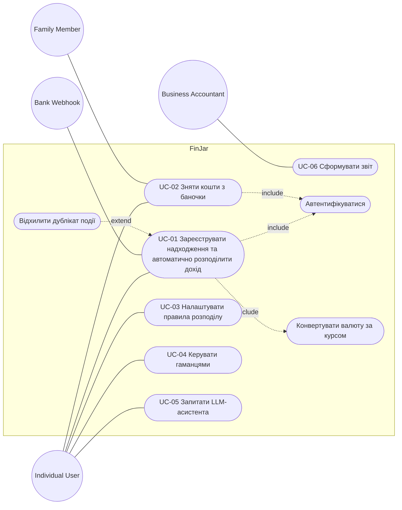

# РОЗДІЛ 2. ПРОЄКТУВАННЯ АРХІТЕКТУРИ СИСТЕМИ

## 2.1 Контекстне та контейнерне моделювання системи (C4 Model)

### Рівень 1. System Context Diagram

Система FinJar взаємодіє з трьома ролями користувачів та п'ятьма зовнішніми системами. Вхідні webhook-події від банку та платіжного провайдера автентифікуються підписом HMAC-SHA256 відповідно до [SRS-NFR-SEC-04](srs.md#srs-nfr-sec-04). Обмін з LLM Provider містить лише агреговані знеособлені дані ([SRS-FUN-13](srs.md#srs-fun-13)).

### Рівень 2. Container Diagram

Опис контейнерів та трасування вимог:

- **Web App** реалізує інтерфейс користувача англійською мовою та звертається до Core API через REST / HTTPS з JWT ([SRS-FUN-01](srs.md#srs-fun-01)).
- **Reverse Proxy (Nginx)** завершує TLS 1.2+ ([SRS-NFR-SEC-02](srs.md#srs-nfr-sec-02)).
- **Core API** — stateless-контейнер ([SRS-NFR-OPS-01](srs.md#srs-nfr-ops-01)), що реалізує модулі гаманців, реєстру та баночок ([SRS-FUN-02](srs.md#srs-fun-02) – [SRS-FUN-12](srs.md#srs-fun-12)); rate limiting виконується через Redis ([SRS-NFR-SEC-03](srs.md#srs-nfr-sec-03)).
- **Async Workers** обробляють події розподілу доходу ([SRS-FUN-08](srs.md#srs-fun-08)) через RabbitMQ відповідно до рішення [ADR-001](adr/0001-choice-of-technology.md).
- **Primary DB** зберігає реєстр подвійного запису ([SRS-FUN-04](srs.md#srs-fun-04)) і таблицю Outbox ([SRS-NFR-REL-02](srs.md#srs-nfr-rel-02)).
- **Observability** забезпечує trace ID для кожного запиту ([SRS-NFR-OBS-01](srs.md#srs-nfr-obs-01)).

## 2.2 Компонентне моделювання критичного сервісу системи

Критичним обрано контейнер **Async Workers** у частині модуля `jars` — сервіс розподілу доходу (Allocation Service), що забезпечує ідемпотентне застосування процентних правил до подій надходження.

### Рівень 3. Component Diagram — Allocation Service

Опис компонентів:

- **IncomeEventConsumer** — вхідний шар; підтверджує повідомлення (`acks_late`) лише після commit транзакції, що забезпечує at-least-once обробку ([SRS-NFR-REL-02](srs.md#srs-nfr-rel-02)).
- **EventSchemaValidator** — валідація DTO події до виконання бізнес-логіки; невалідні події одразу направляються в dead-letter exchange.
- **IdempotencyGuard** — вставка `event_id` у таблицю `processed_events` з унікальним обмеженням у тій самій транзакції, що й проводки; повторна подія не змінює стан ([SRS-FUN-08](srs.md#srs-fun-08)).
- **AllocateIncomeUseCase** — доменний сервіс, що залежить від абстракцій `LedgerPort` і `RuleRepository` (принцип інверсії залежностей); прямий доступ вхідного шару до БД відсутній.
- **AllocationRuleEngine** — чиста доменна логіка: обчислення часток у `Decimal` з округленням до двох знаків і віднесенням залишку округлення на останню баночку, що зберігає інваріант подвійного запису ([SRS-NFR-REL-01](srs.md#srs-nfr-rel-01)).
- **AuditPublisher** — запис події аудиту ([SRS-FUN-10](srs.md#srs-fun-10)).
- **TaskErrorHandler** — повторні спроби з експоненційним backoff (до 5 спроб) і відправка в DLX.
- **AllocationMetrics** — гістограма `allocation_latency_seconds` для верифікації [SRS-NFR-PERF-03](srs.md#srs-nfr-perf-03).

## 2.3 Документування архітектурних рішень (Architecture Decision Records)

| ID | Рішення | Статус |
|---|---|---|
| [ADR-001](adr/0001-choice-of-technology.md) | Вибір RabbitMQ як брокера повідомлень для асинхронного розподілу доходу | Approved |

## 2.4 Проєктування та моделювання баз даних

Шар збереження реалізовано в PostgreSQL 16 за принципом Data-as-Code. Грошові суми зберігаються в `NUMERIC(23,8)` (до 8 знаків для криптоактивів), курси — у `NUMERIC(22,10)`, ідентифікатори — `UUID` (v7, впорядковані за часом).

**План індексування:**

| Таблиця | Індекс | Тип | Призначення |
|---|---|---|---|
| `ledger_entries` | `(account_id, transaction_id)` | B-Tree | Обчислення балансу рахунку та виписки |
| `transactions` | `(budget_id, occurred_at DESC)` | B-Tree | Журнал транзакцій з пагінацією за курсором |
| `transactions` | `idempotency_key` UNIQUE | B-Tree | Захист від повторного створення ([SRS-FUN-04](srs.md#srs-fun-04)) |
| `transactions` | `source_event_id` UNIQUE WHERE NOT NULL | Partial B-Tree | Однократний розподіл для події надходження ([SRS-FUN-08](srs.md#srs-fun-08)) |
| `outbox_events` | `created_at` WHERE `published_at IS NULL` | Partial B-Tree | Вибірка неопублікованих подій релеєм |
| `fx_rates` | PK `(base, quote, on_date)` | B-Tree | Пошук курсу на дату |
| `audit_events` | `diff` | GIN | Пошук змін за атрибутами |
| `allocation_rules` | `(budget_id) WHERE is_active` | Partial B-Tree | Вибірка активних правил |

Інваріант подвійного запису контролюється відкладеним (DEFERRABLE INITIALLY DEFERRED) тригером-обмеженням: для кожної транзакції `SUM(amount_base WHERE direction = 'D') = SUM(amount_base WHERE direction = 'C')` ([SRS-NFR-REL-01](srs.md#srs-nfr-rel-01)). Таблиці `ledger_entries` та `audit_events` доступні лише на вставку (append-only) через права ролі БД.

## 2.5 Специфікація міжсервісних контрактів (API)

Контракт REST API описано за підходом API-First у форматі OpenAPI 3.0.3: [openapi.yaml](api/openapi.yaml). Контракт містить 10 маршрутів і 16 схем даних.

Ключові рішення контракту:

- Грошові суми передаються рядками `Money` (pattern `^-?\d{1,15}(\.\d{1,8})?$`), що відповідає `NUMERIC(23,8)` у БД та виключає похибки float у JavaScript-клієнті.
- Створення транзакцій, гаманців і зняття з баночок вимагає заголовка `Idempotency-Key` (UUID), що відповідає унікальному індексу `transactions.idempotency_key`.
- Помилки повертаються у форматі RFC 7807 (`application/problem+json`) з `trace_id`; задокументовано коди 400, 401, 402, 403, 404, 409, 422, 429, 504.
- Пагінація журналів виконується за курсором (`cursor`, `limit ≤ 100`).
- Вебхук `/webhooks/bank` автентифікується заголовком `X-Signature` (HMAC-SHA256) і повертає 202 з подальшою асинхронною обробкою.

## 2.6 Моделювання логіки критичних вузлів

### 2.6.1 Алгоритм ідемпотентного розподілу доходу за баночками

Вхідні дані: подія `E` (event_id, budget_id, amount `A`, currency), впорядкований за `priority` масив активних правил `R[1..n]` з частками `R[i].percent`.

1. Початок; ввести подію `E`.
2. Якщо `event_id` уже є в `processed_events`, завершити без змін.
3. Отримати правила `R[1..n]`; якщо `n = 0 OR SUM(R[i].percent) ≠ 100`, записати помилку конфігурації та завершити.
4. `allocated := 0`; `i := 1`.
5. Поки `i ≤ n`: якщо `i < n`, то `share[i] := ROUND(A × R[i].percent / 100, 2)`, інакше `share[i] := A − allocated`; `allocated := allocated + share[i]`; `i := i + 1`.
6. Сформувати проводки: дебет `Jar[R[i].jar]` на `share[i]`, кредит рахунку надходження на `A`.
7. Якщо `SUM(debit) = SUM(credit) AND allocated = A`, зафіксувати транзакцію та `event_id` в одній ACID-транзакції; інакше відкотити транзакцію.
8. Кінець.

### 2.6.2 Алгоритм реєстрації мультивалютної транзакції

Вхідні дані: проводки `Entry[1..m]` з `amount`, `currency`, `direction`; базова валюта бюджету `B`; дата операції `d`.

1. Початок; ввести `Entry[1..m]`, `B`, `d`.
2. Якщо `m < 2`, повернути 422.
3. `j := 1`; поки `j ≤ m`: якщо `Entry[j].currency = B`, то `rate := 1`, інакше `rate := FxRate(Entry[j].currency, B, d)`; якщо курс відсутній, повернути 422; `Entry[j].amount_base := ROUND(Entry[j].amount × rate, 2)`; `j := j + 1`.
4. `delta := ΣEntry[j].amount_base(D) − ΣEntry[j].amount_base(C)`.
5. Якщо `|delta| > 0 AND |delta| ≤ 0.01 × m`, додати проводку курсової різниці на рахунок `fx` на суму `delta`; якщо `|delta| > 0.01 × m`, повернути 422.
6. Зберегти транзакцію, проводки та подію Outbox в одній ACID-транзакції; повернути 201.
7. Кінець.

## 2.7 Інтеграційний аудит та верифікація цілісності доменів

**Production Readiness Report** — результат перехресної перевірки ERD (2.4), контракту OpenAPI (2.5) та алгоритмів (2.6).

| Перевірка | Результат |
|---|---|
| Тип грошових сум: `NUMERIC(23,8)` у БД ↔ `Money` (decimal string, до 8 знаків) в API ↔ `Decimal` в алгоритмах | Узгоджено |
| Курси: `NUMERIC(22,10)` у `fx_rates` ↔ `FxRate.rate` (до 10 знаків) ↔ `rate` в алгоритмі 2.6.2 | Узгоджено |
| Частки правил: `NUMERIC(5,2)` ↔ `AllocationRule.percent` ↔ умова `ΣR[i].percent = 100` | Узгоджено |
| Ідемпотентність: `transactions.idempotency_key` UK ↔ заголовок `Idempotency-Key` ↔ `processed_events` в алгоритмі 2.6.1 | Узгоджено |
| Коди валют: `varchar(10)` ↔ `CurrencyCode` `^[A-Z0-9]{3,10}$` (ISO 4217 та тикери криптоактивів) | Виправлено: початково `char(3)` у `ledger_accounts` не вміщував тикери USDT/BTC-подібної довжини > 3 |
| Коментар зняття: `varchar(500)` ↔ `JarWithdrawal.comment maxLength 500` ↔ SRS-FUN-09 | Узгоджено |
| Порядок правил: `allocation_rules.priority` ↔ `AllocationRule.priority` ↔ впорядкований масив `R[1..n]` | Виправлено: поле `priority` додано в ERD після аудиту |
| Обмеження `transactions.kind`: значення `allocation` створюється лише воркером і відсутнє в `TransactionCreate.kind` | Узгоджено (навмисне обмеження API) |

Конфліктів типів і семантичних розбіжностей між шарами після виправлень не виявлено.

## 2.8 Обґрунтування архітектурного стилю та патернів проєктування

**Глобальний архітектурний стиль.** Для FinJar обрано модульний моноліт (Modular Monolith) на Django REST Framework з виділеним асинхронним контуром обробки подій (Celery, RabbitMQ). Доменні модулі `wallets`, `ledger`, `fx`, `jars`, `billing`, `assistant`, `reports` мають власні моделі, сервіси та публічні інтерфейси; міжмодульні виклики виконуються лише через сервісний шар, прямий імпорт моделей іншого модуля заборонено правилом статичного аналізу (import-linter). Усі модулі працюють з однією базою PostgreSQL, що дозволяє фіксувати транзакцію, проводки подвійного запису та подію Outbox в одній ACID-транзакції без розподілених саг.

Вибір забезпечує виконання NFR таким чином. Вимога затримки читання p95 ≤ 200 мс при 300 RPS ([SRS-NFR-PERF-01](srs.md#srs-nfr-perf-01)) досягається відсутністю мережевих викликів між модулями в межах запиту, кешуванням курсів валют у Redis та курсорною пагінацією. Вимога розподілу доходу ≤ 5 с ([SRS-NFR-PERF-03](srs.md#srs-nfr-perf-03)) виконується винесенням розподілу з HTTP-запиту в Celery-воркери; кількість воркерів масштабується горизонтально без зміни коду. Stateless-контейнери Core API ([SRS-NFR-OPS-01](srs.md#srs-nfr-ops-01)) масштабуються за балансувальником Nginx.

Компроміс стилю: спільна база даних обмежує незалежне масштабування окремих модулів, а релізи всіх модулів виконуються синхронно. Для обсягу навантаження дипломного проєкту цей компроміс прийнятний; межі модулів спроєктовано так, щоб модуль `assistant` або `reports` за потреби виділявся в окремий сервіс без зміни доменної моделі реєстру.

**Патерни мікрорівня:**

- **Service Layer + Repository** — ізолюють бізнес-логіку від Django ORM; доменні сервіси залежать від інтерфейсів репозиторіїв (принцип інверсії залежностей), що знижує зв'язність і дозволяє тестувати логіку без бази даних.
- **Unit of Work** (`transaction.atomic`) — гарантує атомарність запису транзакції, проводок, `processed_events` і Outbox.
- **Transactional Outbox + Idempotent Consumer** — забезпечують at-least-once доставку подій без дублювання ефектів ([SRS-NFR-REL-02](srs.md#srs-nfr-rel-02)).
- **Strategy** — окремі стратегії обчислення для типів гаманців (`credit_card` враховує ліміт і заборгованість) та для провайдерів курсів валют.
- **Dependency Injection** — збирання залежностей сервісів на рівні фабрик модулів; у тестах реалізації підміняються in-memory репозиторіями.
- **Read-only Tool Gateway** для LLM-асистента — асистент отримує доступ лише до переліку дозволених read-only функцій, що виключає зміну даних моделлю ([SRS-FUN-13](srs.md#srs-fun-13)).

## 2.9 Опис серверного ядра та контур безпеки застосунку (Application Security)

**Шлях даних через рівні Core API.** Inbound Layer: Nginx завершує TLS 1.2+ і передає запит у Gunicorn; middleware-ланцюжок Django виконує: присвоєння trace ID (OpenTelemetry), обмеження частоти запитів (Redis Token Bucket), автентифікацію JWT (SimpleJWT), перевірку RBAC-ролі в бюджеті (`IsBudgetMember`, `IsBudgetOwner`), перевірку тарифу (`PlanFeatureGuard`). Серіалізатори DRF валідують DTO: типи, діапазони, pattern для `Money` і `CurrencyCode`. Core Layer: доменні сервіси (`PostTransactionService`, `AllocationRuleService`, `JarWithdrawalService`) виконують бізнес-правила та інваріанти. Outbound Layer: репозиторії Django ORM, клієнти FX API та LLM API з таймаутами та circuit breaker.

**Контур AppSec (OWASP Top 10:2021, OWASP ASVS 4.0 L2):**

| Загроза | Механізм захисту |
|---|---|
| A01 Broken Access Control / IDOR | Кожен запит фільтрується за `budget_id` поточного учасника на рівні queryset репозиторію; доступ до чужого ресурсу повертає 404 (не 403), щоб не розкривати факт існування |
| A02 Cryptographic Failures | TLS 1.2+; Argon2id для паролів; AES-256-GCM для чутливих полів (адреси криптогаманців); секрети — у змінних середовища, не в репозиторії |
| A03 Injection | Лише параметризовані запити Django ORM; заборона raw SQL правилом Bandit; екранування вихідних даних у Next.js |
| A04 Insecure Design | Інваріант подвійного запису на рівні БД; ідемпотентні ключі; ліміт розміру тіла запиту 1 МБ |
| A05 Security Misconfiguration | `DEBUG=False`, суворий CORS-список доменів, заголовки HSTS, CSP, X-Content-Type-Options |
| A07 Identification & Auth Failures | Access JWT 15 хв, refresh 7 діб з ротацією та blacklist; 10 спроб входу/хв на IP |
| A08 Software & Data Integrity | HMAC-SHA256 для webhook з перевіркою timestamp (вікно 5 хв) проти replay; закріплені версії залежностей; Trivy та Dependabot |
| A09 Logging & Monitoring Failures | Append-only `audit_events`; структуровані логи з trace ID без персональних даних |
| A10 SSRF | Вихідні HTTP-запити лише на allowlist доменів FX і LLM провайдерів |
| LLM Prompt Injection | Асистент отримує лише агреговані дані; виклики інструментів обмежені read-only allowlist; вихід моделі не виконується як код |

## 2.10 Топологія API-маршрутів та потоки даних

Таблиця 2.1 — Карта інтерфейсних маршрутів системи

| ID | Метод | URI | Вхідні параметри / Payload | Призначення та контейнер-обробник |
|---|---|---|---|---|
| API-REQ-01 | POST | `/api/v1/auth/token` | body: `email: string(email)`, `password: string(12..128)` | Видача JWT; Core API (`auth`) |
| API-REQ-02 | POST | `/api/v1/auth/token/refresh` | body: `refresh: string` | Ротація refresh-токена; Core API (`auth`) |
| API-REQ-03 | GET | `/api/v1/wallets` | query: `budget_id: uuid`, `cursor`, `limit ≤ 100` | Список гаманців; Core API (`wallets`) |
| API-REQ-04 | POST | `/api/v1/wallets` | header `Idempotency-Key: uuid`; body `WalletCreate` | Створення гаманця; Core API (`wallets`) |
| API-REQ-05 | GET | `/api/v1/transactions` | query: `budget_id`, `wallet_id`, `from`, `to`, `cursor`, `limit` | Журнал транзакцій; Core API (`ledger`) |
| API-REQ-06 | POST | `/api/v1/transactions` | header `Idempotency-Key`; body `TransactionCreate` (2..50 проводок, `Money`) | Реєстрація транзакції, запис Outbox; Core API (`ledger`) → Async Workers (`jars`) |
| API-REQ-07 | GET | `/api/v1/jars` | query: `budget_id` | Баночки з балансами; Core API (`jars`) |
| API-REQ-08 | PUT | `/api/v1/jars/allocation-rules` | query: `budget_id`; body: масив `AllocationRule` (1..20) | Заміна правил розподілу; Core API (`jars`) |
| API-REQ-09 | POST | `/api/v1/jars/{jarId}/withdrawals` | path `jarId: uuid`; header `Idempotency-Key`; body `JarWithdrawal` | Зняття з баночки з коментарем; Core API (`jars`) |
| API-REQ-10 | GET | `/api/v1/fx/rates` | query: `base`, `quote`, `date` | Курс валют на дату; Core API (`fx`) |
| API-REQ-11 | POST | `/api/v1/assistant/queries` | body: `question: string(1..1000)`, `budget_id` | Запит до LLM-асистента; Core API → Async Workers (`assistant`) |
| API-REQ-12 | POST | `/api/v1/webhooks/bank` | header `X-Signature`; body: `event_id`, `amount`, `currency`, `occurred_at` | Прийом банківської події; Core API (`ledger`) |

Усі мутуючі маршрути (POST, PUT) крім API-REQ-01, API-REQ-02 та API-REQ-12 вимагають `Authorization: Bearer <JWT>`; API-REQ-12 автентифікується підписом HMAC.

**Data Flow: надходження заробітної плати та автоматичний розподіл.**

1. Web App надсилає `POST /api/v1/transactions` (kind `income`, заголовок `Idempotency-Key`) через HTTPS на Nginx.
2. Nginx завершує TLS і передає запит у Core API; middleware перевіряє rate limit у Redis, валідує JWT та роль `owner` або `member` у бюджеті.
3. Серіалізатор валідує DTO; `PostTransactionService` отримує курси з Redis (за відсутності — з таблиці `fx_rates`) та обчислює `amount_base` кожної проводки.
4. В одній ACID-транзакції PostgreSQL записуються `transactions`, `ledger_entries`, `audit_events` та подія `IncomeReceived` в `outbox_events`; клієнт отримує 201.
5. Celery Beat кожні 2 с запускає Outbox-релей, який публікує неопубліковані події в чергу `allocation` RabbitMQ (AMQP) і позначає `published_at`.
6. Allocation Service отримує подію, перевіряє `processed_events`, обчислює частки `share[i]` за правилами та записує проводки розподілу в одній транзакції; повідомлення підтверджується після commit.
7. Web App оновлює баланси баночок запитом `GET /api/v1/jars` (TanStack Query, інвалідація кешу після успішної мутації).

## 2.11 Моделювання користувацького досвіду та транзакційних сценаріїв (Use Cases)

### UC-01: Реєстрація надходження та автоматичний розподіл доходу

| Атрибут | Значення |
|---|---|
| Актори | Individual User (основний), Bank Webhook (вторинний) |
| Передумови | Користувач автентифікований; існує гаманець отримувача; активні правила з сумою часток 100% |
| Тригер | Користувач вносить надходження або банк надсилає webhook |

Таблиця 2.2 — Main Success Scenario UC-01

| Крок | Дія актора | Реакція системи (Backend / БД) |
|---|---|---|
| 1 | Вводить суму 15000.00 UAH, гаманець, дату та натискає Save | Web App надсилає `POST /transactions` з `Idempotency-Key` |
| 2 | — | Core API валідує JWT, роль і DTO; перевіряє унікальність `Idempotency-Key` |
| 3 | — | Обчислює `amount_base`, записує транзакцію, проводки та Outbox-подію в одній транзакції; повертає 201 |
| 4 | Бачить транзакцію в журналі | Outbox-релей публікує `IncomeReceived` у RabbitMQ |
| 5 | — | Allocation Service записує `event_id` у `processed_events` і проводки розподілу (30/10/30/30%) в одній транзакції |
| 6 | Бачить оновлені баланси баночок | `GET /jars` повертає нові баланси |

**Постумови:** у реєстрі зафіксовано транзакцію надходження та транзакцію розподілу; суми дебету та кредиту рівні; записи аудиту створено.

Таблиця 2.3 — Alternative Flows UC-01

| ID | Старт із кроку | Умова | Реакція системи | Повернення |
|---|---|---|---|---|
| AF-01A | Крок 2 | Повторний `Idempotency-Key` з тим самим тілом | Повертає 201 з раніше створеною транзакцією без нового запису | Крок 4 |
| AF-01B | Крок 2 | Повторний `Idempotency-Key` з іншим тілом | Повертає 409 Conflict | Крок 1 |
| AF-01C | Крок 3 | Курс валюти на дату відсутній | Повертає 422 з полем `currency`; транзакцію не створено | Крок 1 |
| AF-01D | Крок 5 | Сума часток правил ≠ 100% після зміни правил | Розподіл не виконується, подія позначається `config_error`, користувач отримує сповіщення | Завершення |

Таблиця 2.4 — Exception Flows UC-01

| ID | Крок | Збій | Реакція системи |
|---|---|---|---|
| EF-01A | Крок 3 | PostgreSQL недоступний | Транзакція не фіксується; 503 з `Retry-After`; клієнт повторює запит з тим самим `Idempotency-Key` |
| EF-01B | Крок 4 | RabbitMQ недоступний | Подія залишається в Outbox з `published_at = NULL`; релей повторює публікацію після відновлення |
| EF-01C | Крок 5 | Воркер аварійно завершився до commit | Повідомлення не підтверджене (`acks_late`) і повторно доставляється; `processed_events` виключає дублювання |
| EF-01D | Крок 5 | 5 невдалих спроб обробки | Повідомлення переміщується в dead-letter queue; алерт Prometheus; ручний розбір |

### UC-02: Зняття коштів з баночки

| Атрибут | Значення |
|---|---|
| Актори | Individual User, Family Member (роль `member`) |
| Передумови | Користувач має роль `owner` або `member`; баланс баночки > 0 |

Таблиця 2.5 — Main Success Scenario UC-02

| Крок | Дія актора | Реакція системи (Backend / БД) |
|---|---|---|
| 1 | Обирає баночку, вводить суму, гаманець і коментар | Web App надсилає `POST /jars/{jarId}/withdrawals` з `Idempotency-Key` |
| 2 | — | Core API перевіряє роль, валідує коментар (1..500 символів) |
| 3 | — | Блокує рядок балансу баночки (`SELECT ... FOR UPDATE`), перевіряє достатність коштів |
| 4 | — | Записує проводки (дебет гаманця, кредит баночки) та аудит; повертає 201 |
| 5 | Бачить новий баланс і коментар в історії | — |

Таблиця 2.6 — Alternative та Exception Flows UC-02

| ID | Тип | Крок | Умова / збій | Реакція системи |
|---|---|---|---|---|
| AF-02A | Alternative | Крок 3 | Недостатньо коштів | 409 з `detail: insufficient_funds`; повернення на крок 1 |
| AF-02B | Alternative | Крок 2 | Роль `viewer` | 403; операція недоступна |
| EF-02A | Exception | Крок 3 | Таймаут блокування рядка (конкурентне зняття) | Відкат транзакції, 503 з `Retry-After: 1` |

## Висновки до розділу 2

У розділі обґрунтовано архітектуру модульного моноліту на Django REST Framework з асинхронним контуром Celery та RabbitMQ, що забезпечує атомарний запис транзакцій подвійного запису та подій Outbox в одній базі PostgreSQL без розподілених саг. Архітектуру змодельовано на трьох рівнях C4 Model з наскрізним трасуванням контейнерів і компонентів на вимоги SRS, а вибір брокера повідомлень зафіксовано в ADR-001 з аналізом компромісів.

Спроєктовано модель даних реєстру з типом `NUMERIC` для сум, унікальними ключами ідемпотентності та планом індексування; специфіковано REST-контракт OpenAPI 3.0.3 з 10 маршрутами, форматом помилок RFC 7807 та обов'язковими ключами ідемпотентності; алгоритмізовано розподіл доходу та реєстрацію мультивалютної транзакції. Контур безпеки охоплює категорії OWASP Top 10, а сценарії Use Case описують основні, альтернативні та виключні потоки з відкатом транзакцій.

Інтеграційний аудит підтвердив узгодженість типів між моделлю даних, API-контрактом та алгоритмами. Архітектурне ядро готове до програмної реалізації, тестування та розгортання, що є предметом Розділу 3.
