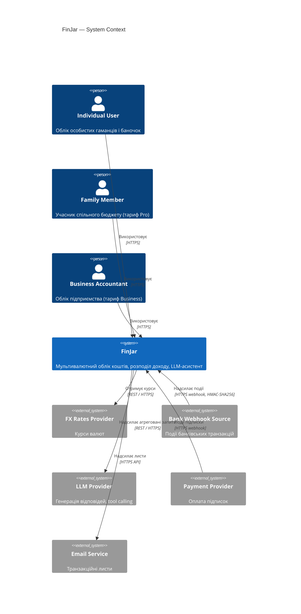
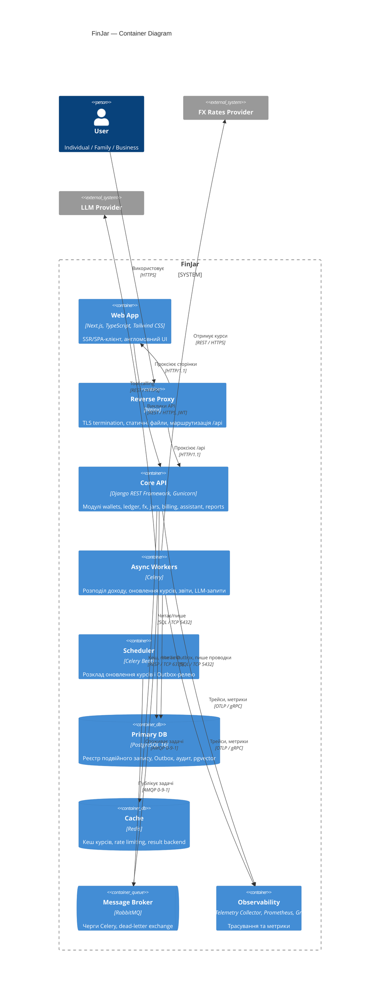
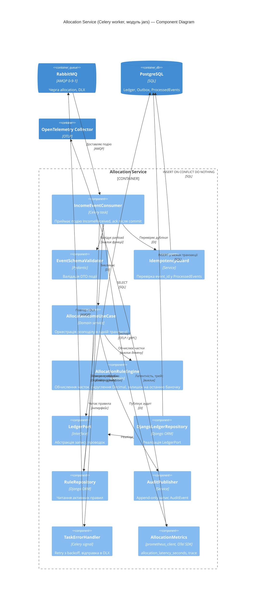
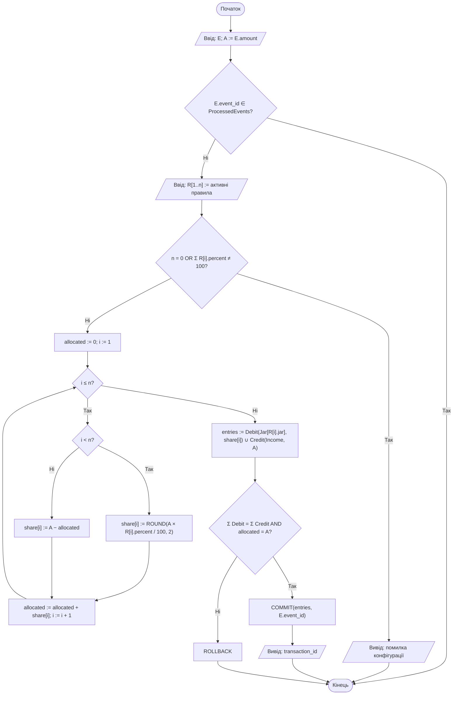
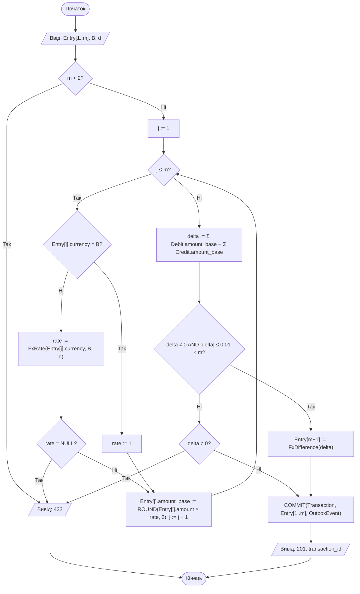

# РОЗДІЛ 2. ПРОЄКТУВАННЯ АРХІТЕКТУРИ СИСТЕМИ

## 2.1 Контекстне та контейнерне моделювання системи (C4 Model)

### Рівень 1. System Context Diagram

Система FinJar взаємодіє з трьома ролями користувачів та п'ятьма зовнішніми системами. Вхідні webhook-події від банку та платіжного провайдера автентифікуються підписом HMAC-SHA256 відповідно до [SRS-NFR-SEC-04](srs.md#srs-nfr-sec-04). Обмін з LLM Provider містить лише агреговані знеособлені дані ([SRS-FUN-13](srs.md#srs-fun-13)).

### Рівень 2. Container Diagram

Опис контейнерів та трасування вимог:

- **Web App** реалізує інтерфейс користувача англійською мовою та звертається до Core API через REST / HTTPS з JWT ([SRS-FUN-01](srs.md#srs-fun-01)).
- **Reverse Proxy (Nginx)** завершує TLS 1.2+ ([SRS-NFR-SEC-02](srs.md#srs-nfr-sec-02)).
- **Core API** — stateless-контейнер ([SRS-NFR-OPS-01](srs.md#srs-nfr-ops-01)), що реалізує модулі гаманців, реєстру та баночок ([SRS-FUN-02](srs.md#srs-fun-02) – [SRS-FUN-12](srs.md#srs-fun-12)); rate limiting виконується через Redis ([SRS-NFR-SEC-03](srs.md#srs-nfr-sec-03)).
- **Async Workers** обробляють події розподілу доходу ([SRS-FUN-08](srs.md#srs-fun-08)) через RabbitMQ відповідно до рішення [ADR-001](adr/0001-choice-of-technology.md).
- **Primary DB** зберігає реєстр подвійного запису ([SRS-FUN-04](srs.md#srs-fun-04)) і таблицю Outbox ([SRS-NFR-REL-02](srs.md#srs-nfr-rel-02)).
- **Observability** забезпечує trace ID для кожного запиту ([SRS-NFR-OBS-01](srs.md#srs-nfr-obs-01)).

## 2.2 Компонентне моделювання критичного сервісу системи

Критичним обрано контейнер **Async Workers** у частині модуля `jars` — сервіс розподілу доходу (Allocation Service), що забезпечує ідемпотентне застосування процентних правил до подій надходження.

### Рівень 3. Component Diagram — Allocation Service

Опис компонентів:

- **IncomeEventConsumer** — вхідний шар; підтверджує повідомлення (`acks_late`) лише після commit транзакції, що забезпечує at-least-once обробку ([SRS-NFR-REL-02](srs.md#srs-nfr-rel-02)).
- **EventSchemaValidator** — валідація DTO події до виконання бізнес-логіки; невалідні події одразу направляються в dead-letter exchange.
- **IdempotencyGuard** — вставка `event_id` у таблицю `processed_events` з унікальним обмеженням у тій самій транзакції, що й проводки; повторна подія не змінює стан ([SRS-FUN-08](srs.md#srs-fun-08)).
- **AllocateIncomeUseCase** — доменний сервіс, що залежить від абстракцій `LedgerPort` і `RuleRepository` (принцип інверсії залежностей); прямий доступ вхідного шару до БД відсутній.
- **AllocationRuleEngine** — чиста доменна логіка: обчислення часток у `Decimal` з округленням до двох знаків і віднесенням залишку округлення на останню баночку, що зберігає інваріант подвійного запису ([SRS-NFR-REL-01](srs.md#srs-nfr-rel-01)).
- **AuditPublisher** — запис події аудиту ([SRS-FUN-10](srs.md#srs-fun-10)).
- **TaskErrorHandler** — повторні спроби з експоненційним backoff (до 5 спроб) і відправка в DLX.
- **AllocationMetrics** — гістограма `allocation_latency_seconds` для верифікації [SRS-NFR-PERF-03](srs.md#srs-nfr-perf-03).

## 2.3 Документування архітектурних рішень (Architecture Decision Records)

| ID | Рішення | Статус |
|---|---|---|
| [ADR-001](adr/0001-choice-of-technology.md) | Вибір RabbitMQ як брокера повідомлень для асинхронного розподілу доходу | Approved |

## 2.4 Проєктування та моделювання баз даних

Шар збереження реалізовано в PostgreSQL 16 за принципом Data-as-Code. Грошові суми зберігаються в `NUMERIC(23,8)` (до 8 знаків для криптоактивів), курси — у `NUMERIC(22,10)`, ідентифікатори — `UUID` (v7, впорядковані за часом).

**План індексування:**

| Таблиця | Індекс | Тип | Призначення |
|---|---|---|---|
| `ledger_entries` | `(account_id, transaction_id)` | B-Tree | Обчислення балансу рахунку та виписки |
| `transactions` | `(budget_id, occurred_at DESC)` | B-Tree | Журнал транзакцій з пагінацією за курсором |
| `transactions` | `idempotency_key` UNIQUE | B-Tree | Захист від повторного створення ([SRS-FUN-04](srs.md#srs-fun-04)) |
| `transactions` | `source_event_id` UNIQUE WHERE NOT NULL | Partial B-Tree | Однократний розподіл для події надходження ([SRS-FUN-08](srs.md#srs-fun-08)) |
| `outbox_events` | `created_at` WHERE `published_at IS NULL` | Partial B-Tree | Вибірка неопублікованих подій релеєм |
| `fx_rates` | PK `(base, quote, on_date)` | B-Tree | Пошук курсу на дату |
| `audit_events` | `diff` | GIN | Пошук змін за атрибутами |
| `allocation_rules` | `(budget_id) WHERE is_active` | Partial B-Tree | Вибірка активних правил |

Інваріант подвійного запису контролюється відкладеним (DEFERRABLE INITIALLY DEFERRED) тригером-обмеженням: для кожної транзакції `SUM(amount_base WHERE direction = 'D') = SUM(amount_base WHERE direction = 'C')` ([SRS-NFR-REL-01](srs.md#srs-nfr-rel-01)). Таблиці `ledger_entries` та `audit_events` доступні лише на вставку (append-only) через права ролі БД.

## 2.5 Специфікація міжсервісних контрактів (API)

Контракт REST API описано за підходом API-First у форматі OpenAPI 3.0.3: [openapi.yaml](api/openapi.yaml). Контракт містить 10 маршрутів і 16 схем даних.

Ключові рішення контракту:

- Грошові суми передаються рядками `Money` (pattern `^-?\d{1,15}(\.\d{1,8})?$`), що відповідає `NUMERIC(23,8)` у БД та виключає похибки float у JavaScript-клієнті.
- Створення транзакцій, гаманців і зняття з баночок вимагає заголовка `Idempotency-Key` (UUID), що відповідає унікальному індексу `transactions.idempotency_key`.
- Помилки повертаються у форматі RFC 7807 (`application/problem+json`) з `trace_id`; задокументовано коди 400, 401, 402, 403, 404, 409, 422, 429, 504.
- Пагінація журналів виконується за курсором (`cursor`, `limit ≤ 100`).
- Вебхук `/webhooks/bank` автентифікується заголовком `X-Signature` (HMAC-SHA256) і повертає 202 з подальшою асинхронною обробкою.

## 2.6 Моделювання логіки критичних вузлів

### 2.6.1 Алгоритм ідемпотентного розподілу доходу за баночками

Вхідні дані: подія `E` (event_id, budget_id, amount `A`, currency), впорядкований за `priority` масив активних правил `R[1..n]` з частками `R[i].percent`.

1. Початок; ввести подію `E`.
2. Якщо `event_id` уже є в `processed_events`, завершити без змін.
3. Отримати правила `R[1..n]`; якщо `n = 0 OR SUM(R[i].percent) ≠ 100`, записати помилку конфігурації та завершити.
4. `allocated := 0`; `i := 1`.
5. Поки `i ≤ n`: якщо `i < n`, то `share[i] := ROUND(A × R[i].percent / 100, 2)`, інакше `share[i] := A − allocated`; `allocated := allocated + share[i]`; `i := i + 1`.
6. Сформувати проводки: дебет `Jar[R[i].jar]` на `share[i]`, кредит рахунку надходження на `A`.
7. Якщо `SUM(debit) = SUM(credit) AND allocated = A`, зафіксувати транзакцію та `event_id` в одній ACID-транзакції; інакше відкотити транзакцію.
8. Кінець.

### 2.6.2 Алгоритм реєстрації мультивалютної транзакції

Вхідні дані: проводки `Entry[1..m]` з `amount`, `currency`, `direction`; базова валюта бюджету `B`; дата операції `d`.

1. Початок; ввести `Entry[1..m]`, `B`, `d`.
2. Якщо `m < 2`, повернути 422.
3. `j := 1`; поки `j ≤ m`: якщо `Entry[j].currency = B`, то `rate := 1`, інакше `rate := FxRate(Entry[j].currency, B, d)`; якщо курс відсутній, повернути 422; `Entry[j].amount_base := ROUND(Entry[j].amount × rate, 2)`; `j := j + 1`.
4. `delta := ΣEntry[j].amount_base(D) − ΣEntry[j].amount_base(C)`.
5. Якщо `|delta| > 0 AND |delta| ≤ 0.01 × m`, додати проводку курсової різниці на рахунок `fx` на суму `delta`; якщо `|delta| > 0.01 × m`, повернути 422.
6. Зберегти транзакцію, проводки та подію Outbox в одній ACID-транзакції; повернути 201.
7. Кінець.

## 2.7 Інтеграційний аудит та верифікація цілісності доменів

**Production Readiness Report** — результат перехресної перевірки ERD (2.4), контракту OpenAPI (2.5) та алгоритмів (2.6).

| Перевірка | Результат |
|---|---|
| Тип грошових сум: `NUMERIC(23,8)` у БД ↔ `Money` (decimal string, до 8 знаків) в API ↔ `Decimal` в алгоритмах | Узгоджено |
| Курси: `NUMERIC(22,10)` у `fx_rates` ↔ `FxRate.rate` (до 10 знаків) ↔ `rate` в алгоритмі 2.6.2 | Узгоджено |
| Частки правил: `NUMERIC(5,2)` ↔ `AllocationRule.percent` ↔ умова `ΣR[i].percent = 100` | Узгоджено |
| Ідемпотентність: `transactions.idempotency_key` UK ↔ заголовок `Idempotency-Key` ↔ `processed_events` в алгоритмі 2.6.1 | Узгоджено |
| Коди валют: `varchar(10)` ↔ `CurrencyCode` `^[A-Z0-9]{3,10}$` (ISO 4217 та тикери криптоактивів) | Виправлено: початково `char(3)` у `ledger_accounts` не вміщував тикери USDT/BTC-подібної довжини > 3 |
| Коментар зняття: `varchar(500)` ↔ `JarWithdrawal.comment maxLength 500` ↔ SRS-FUN-09 | Узгоджено |
| Порядок правил: `allocation_rules.priority` ↔ `AllocationRule.priority` ↔ впорядкований масив `R[1..n]` | Виправлено: поле `priority` додано в ERD після аудиту |
| Обмеження `transactions.kind`: значення `allocation` створюється лише воркером і відсутнє в `TransactionCreate.kind` | Узгоджено (навмисне обмеження API) |

Конфліктів типів і семантичних розбіжностей між шарами після виправлень не виявлено.
