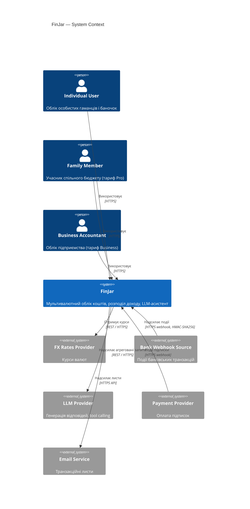
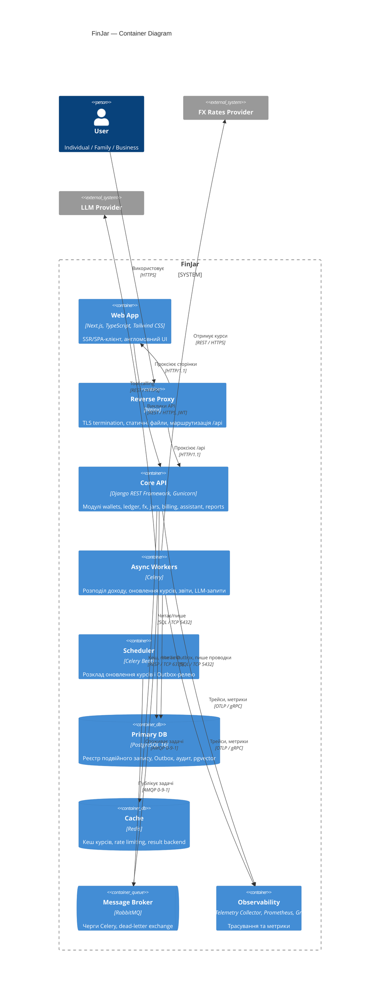
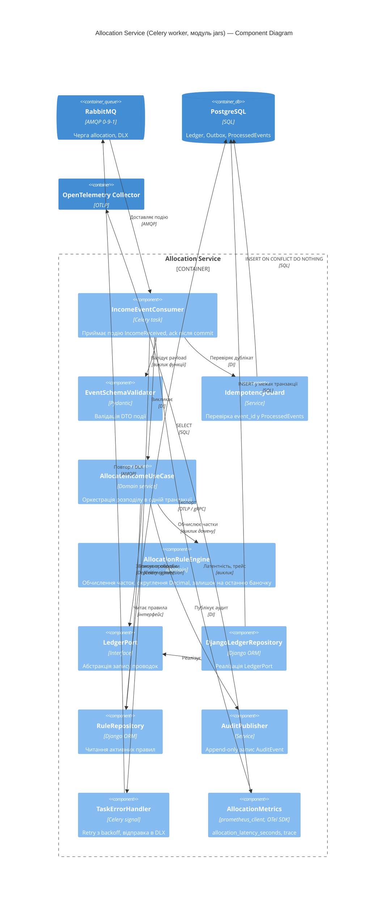

# РОЗДІЛ 2. ПРОЄКТУВАННЯ АРХІТЕКТУРИ СИСТЕМИ

## 2.1 Контекстне та контейнерне моделювання системи (C4 Model)

### Рівень 1. System Context Diagram

Система FinJar взаємодіє з трьома ролями користувачів та п'ятьма зовнішніми системами. Вхідні webhook-події від банку та платіжного провайдера автентифікуються підписом HMAC-SHA256 відповідно до [SRS-NFR-SEC-04](srs.md#srs-nfr-sec-04). Обмін з LLM Provider містить лише агреговані знеособлені дані ([SRS-FUN-13](srs.md#srs-fun-13)).

### Рівень 2. Container Diagram

Опис контейнерів та трасування вимог:

- **Web App** реалізує інтерфейс користувача англійською мовою та звертається до Core API через REST / HTTPS з JWT ([SRS-FUN-01](srs.md#srs-fun-01)).
- **Reverse Proxy (Nginx)** завершує TLS 1.2+ ([SRS-NFR-SEC-02](srs.md#srs-nfr-sec-02)).
- **Core API** — stateless-контейнер ([SRS-NFR-OPS-01](srs.md#srs-nfr-ops-01)), що реалізує модулі гаманців, реєстру та баночок ([SRS-FUN-02](srs.md#srs-fun-02) – [SRS-FUN-12](srs.md#srs-fun-12)); rate limiting виконується через Redis ([SRS-NFR-SEC-03](srs.md#srs-nfr-sec-03)).
- **Async Workers** обробляють події розподілу доходу ([SRS-FUN-08](srs.md#srs-fun-08)) через RabbitMQ відповідно до рішення [ADR-001](adr/0001-choice-of-technology.md).
- **Primary DB** зберігає реєстр подвійного запису ([SRS-FUN-04](srs.md#srs-fun-04)) і таблицю Outbox ([SRS-NFR-REL-02](srs.md#srs-nfr-rel-02)).
- **Observability** забезпечує trace ID для кожного запиту ([SRS-NFR-OBS-01](srs.md#srs-nfr-obs-01)).

## 2.2 Компонентне моделювання критичного сервісу системи

Критичним обрано контейнер **Async Workers** у частині модуля `jars` — сервіс розподілу доходу (Allocation Service), що забезпечує ідемпотентне застосування процентних правил до подій надходження.

### Рівень 3. Component Diagram — Allocation Service

Опис компонентів:

- **IncomeEventConsumer** — вхідний шар; підтверджує повідомлення (`acks_late`) лише після commit транзакції, що забезпечує at-least-once обробку ([SRS-NFR-REL-02](srs.md#srs-nfr-rel-02)).
- **EventSchemaValidator** — валідація DTO події до виконання бізнес-логіки; невалідні події одразу направляються в dead-letter exchange.
- **IdempotencyGuard** — вставка `event_id` у таблицю `processed_events` з унікальним обмеженням у тій самій транзакції, що й проводки; повторна подія не змінює стан ([SRS-FUN-08](srs.md#srs-fun-08)).
- **AllocateIncomeUseCase** — доменний сервіс, що залежить від абстракцій `LedgerPort` і `RuleRepository` (принцип інверсії залежностей); прямий доступ вхідного шару до БД відсутній.
- **AllocationRuleEngine** — чиста доменна логіка: обчислення часток у `Decimal` з округленням до двох знаків і віднесенням залишку округлення на останню баночку, що зберігає інваріант подвійного запису ([SRS-NFR-REL-01](srs.md#srs-nfr-rel-01)).
- **AuditPublisher** — запис події аудиту ([SRS-FUN-10](srs.md#srs-fun-10)).
- **TaskErrorHandler** — повторні спроби з експоненційним backoff (до 5 спроб) і відправка в DLX.
- **AllocationMetrics** — гістограма `allocation_latency_seconds` для верифікації [SRS-NFR-PERF-03](srs.md#srs-nfr-perf-03).

## 2.3 Документування архітектурних рішень (Architecture Decision Records)

| ID | Рішення | Статус |
|---|---|---|
| [ADR-001](adr/0001-choice-of-technology.md) | Вибір RabbitMQ як брокера повідомлень для асинхронного розподілу доходу | Approved |
